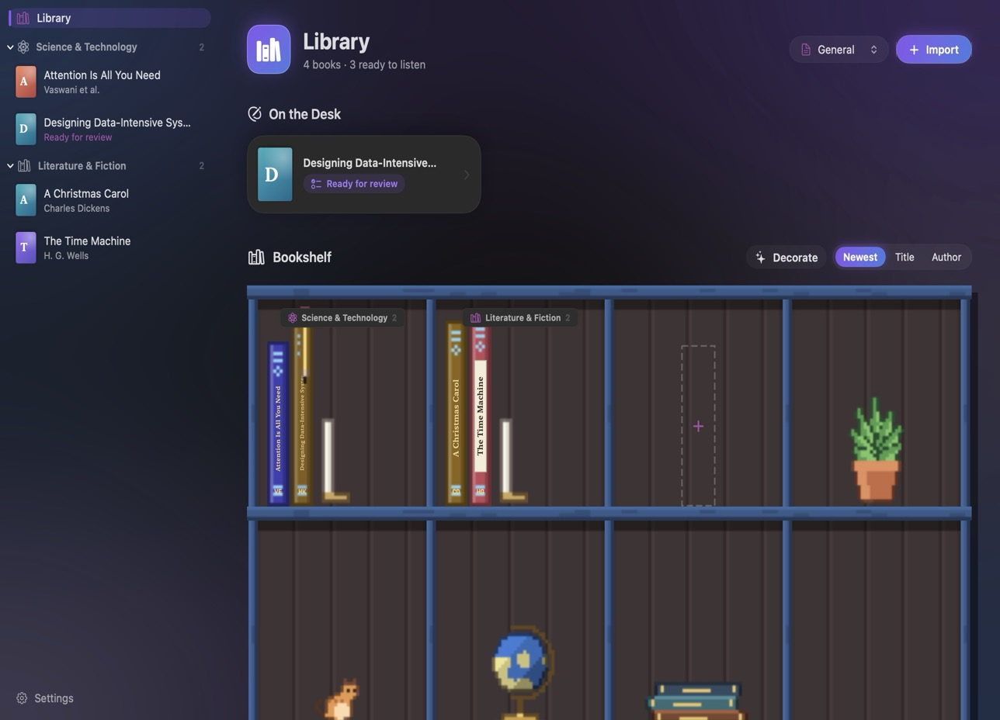
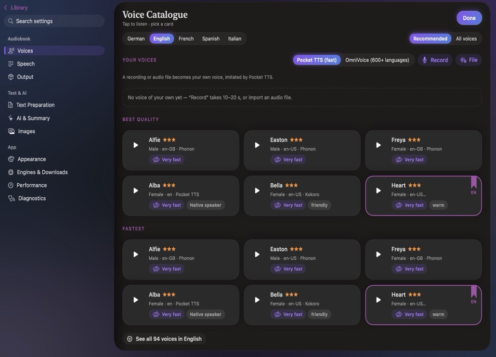
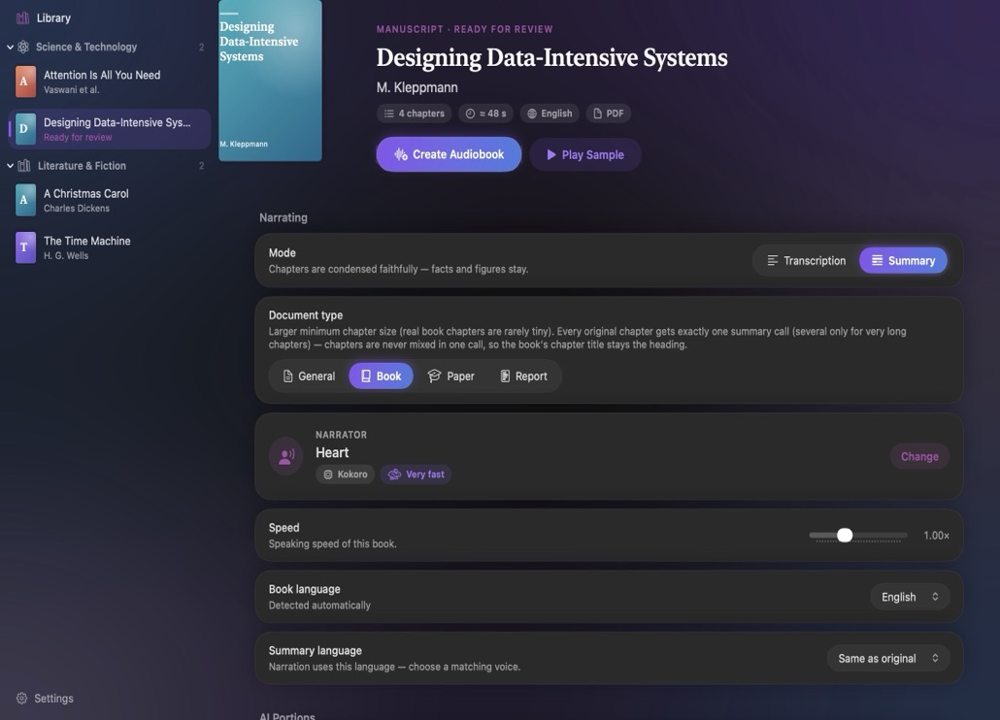
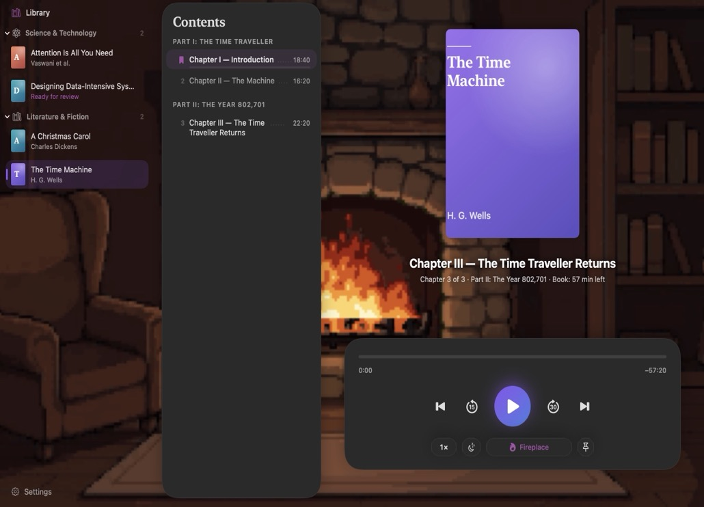
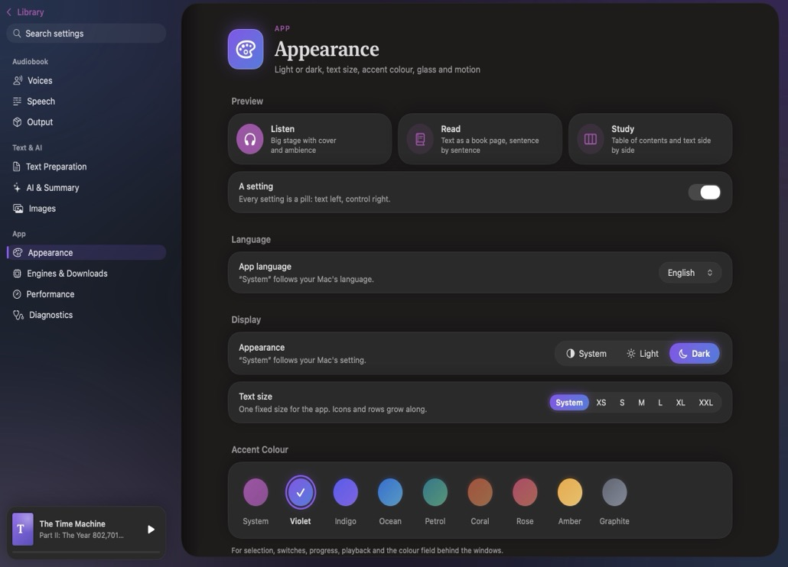

<p align="center">
  
</p>

<h1 align="center">AudiobookForge</h1>

<p align="center">
  <strong>Turn PDFs and EPUBs into chaptered M4B audiobooks on your Mac.</strong><br>
  Local neural TTS · voice cloning · AI summaries &amp; figure descriptions · ambient soundscapes
</p>

<p align="center">
  <a href="https://github.com/pyMoLt/audiobookForge/releases/latest"></a>
  
  
  
  <a href="LICENSE"></a>
</p>

<p align="center">
  
</p>

Drop a PDF or EPUB into AudiobookForge, review the detected chapters, pick a voice and press Start: AudiobookForge produces a chaptered M4B or MP3 audiobook right on your Mac. Document parsing, speech synthesis, voice cloning, loudness normalization and the built-in ambient player all run locally on Apple Silicon. There is no cloud account, no subscription and no telemetry.

## Features

**Document & chapter pipeline**
- Multi-column PDF layout reconstruction, automatic table-of-contents and numbered-heading detection, EPUB3 spine/TOC extraction and Apple Vision OCR fallback for scanned pages.
- Automatic clean-up of page headers, footers, citation brackets, URLs, figure callouts and front/back matter before speech synthesis.
- Calm speech normalization for abbreviations, numbers, units and dates, plus customizable pronunciation lexicons and natural pause rhythm between sentences, paragraphs and headings.
- Post-synthesis quality check with automatic retry and EBU R128 loudness normalization into chaptered `.m4b` (AAC with embedded cover and chapter markers) or tagged `.mp3` chapter files.

**Neural TTS & voice cloning**
- Seven local synthesis backends from ultra-fast native Neural Engine / CPU models to zero-shot voice cloning.
- **236 bundled voice previews** included offline so you can audition every catalog voice before downloading a model.
- Create your own voices via microphone recording or audio file import (`clone:<uuid>`) and use them across supported cloning engines.
- **Re-narrate any book**: right-click a finished audiobook and choose *Re-voice…* to switch voices or engines while keeping all chapter edits, AI summaries and figure descriptions intact.

**Optional local AI summaries & figure descriptions**
- Connect to any local OpenAI-compatible server (oMLX, LM Studio, Ollama) to turn dense textbooks, lecture scripts or papers into structured audio summaries.
- Optional **AI chapter outlining** merges fragmented sections and carries transition context across chunk boundaries.
- Optional **Vision pass** crops charts and diagrams from PDFs and weaves concise spoken figure descriptions into the narration.

**Built-in player & ambient soundscapes**
- Listen inside the app with chapter navigation, playback speed control, sleep timer and automatic position memory.
- Layer procedural pixel-art scenes and **CC0 ambient soundscapes** (fireplace, rain, thunderstorm, ocean waves, stream, night forest, cyberpunk city, night train) underneath your book, with randomized stereo one-shot events.

**Made to feel at home**
- **Flow Design System** with light, dark or system appearance, six accent colors (Violet, Coral, Teal, Amber, Rose, Slate) and scalable typography (XS to XXL).
- Interface available in **English, German, French, Spanish and Italian** (follows macOS or set manually in Settings).

<p align="center">
  
  
</p>
<p align="center">
  
  
</p>

## TTS Engines

Pick the engine that matches your language, speed and voice preferences. Model weights are downloaded only when you install an engine in the app.

| Engine | Languages & Voices | Voice Cloning | Highlights |
|---|---|---|---|
| **Phonon 40m / 31m** (Gradium) | DE, EN, FR, ES · 78 voices | — | Fastest engine (~56× real-time per worker, ~130× in parallel); runs on CPU (`q8`) or Apple Neural Engine (Core ML) |
| **Pocket TTS** (Kyutai) | DE, EN, FR, ES, IT · 24 voices/lang | Yes (local) | ~14× real-time per worker, expressive prosody and fast local voice cloning |
| **Kokoro** (MLX) | EN, DE (Martin, Victoria, Thorsten), FR, ES, IT | — | Crisp reference quality on Apple Silicon GPU via MLX |
| **Piper** (ONNX) | DE, EN · per-voice downloads | — | Lightweight CPU synthesis with adjustable speaking rate and expressiveness |
| **Supertonic** (MLX) | DE, EN | — | Smooth streaming-style cadence |
| **OmniVoice** (MLX) | 600+ languages | Yes (zero-shot) | Broad multilingual zero-shot voice cloning |
| **macOS System Voices** | System-installed voices | — | Zero extra download size; supports macOS Premium/Enhanced voices |

## Install

1. Download `AudiobookForge-4.4.0-macos-arm64.zip` from [Releases](https://github.com/pyMoLt/audiobookForge/releases/latest), unzip it and move **AudiobookForge.app** to `/Applications`.
2. Because the app is **ad-hoc signed** and not notarized with an Apple Developer ID, macOS Gatekeeper blocks the first launch. Either clear the quarantine attribute in Terminal:
   ```bash
   xattr -dr com.apple.quarantine /Applications/AudiobookForge.app
   ```
   or try to open the app once, then go to **System Settings → Privacy & Security** and click **Open Anyway**.
3. Install `ffmpeg` (`brew install ffmpeg`) for M4B/MP3 packaging, pick a TTS engine under **Settings → Engines & Downloads**, and drop in your first PDF or EPUB.

Requirements: a Mac with Apple Silicon (M1 or newer) and macOS 15 or newer.

## Privacy

| What | Where it goes |
|---|---|
| Books, extracted text, chapter audio, voice clones and library data | Stay on your Mac (`~/Library/Application Support/AudiobookForge`) |
| AI summaries & figure descriptions | Sent only to the local/LAN OpenAI-compatible endpoint you configure (`127.0.0.1` by default) |
| Network | Only when you download TTS model weights from Hugging Face |

AudiobookForge never uploads your documents, voice recordings or listening history to any external service.

## Build from source

You need full Xcode 16+, [Tuist](https://tuist.io) (`brew install tuist`) and `ffmpeg` (`brew install ffmpeg`).

```bash
# Generate the Xcode workspace and build Debug
tuist generate --no-open
tuist build

# Run the unit test suite (uses temporary directories and mocked LLM transport)
tuist test

# Build an ad-hoc signed Release app into ../releases/ and /Applications
scripts/build_app.sh
```

| Folder | Contents |
|---|---|
| `AudiobookForge/Sources/App/` | Application entry point, environment wiring, CLI automation hooks |
| `AudiobookForge/Sources/Models/` | `BookProject`, `Chapter`, `RunProgress`, `AppSettings`, `VoiceCatalog` |
| `AudiobookForge/Sources/Pipeline/` | PDF/EPUB extraction, chapter outlining, AI summarization, TTS engines, M4B/MP3 packager |
| `AudiobookForge/Sources/Services/` | `PipelineController`, `LibraryStore`, `AudioPlayerService`, `AmbientEngine`, model managers |
| `AudiobookForge/Sources/UI/` | Flow Design System, library shelf, chapter review, voice gallery, ambient player, settings |
| `AudiobookForge/Resources/` | Python MLX bridges, 236 bundled voice samples, CC0 ambient loops, pixel-art scenes, string catalog |
| `Helpers/` | Precompiled universal-M1 Core ML exporter (`phonon-coreml-export`) for Phonon Neural Engine models |
| `AudiobookForgeTests/` | Unit, snapshot and pipeline integration tests |
| `scripts/` | Build, localization catalog (`l10n_*.json`), scene sprite and ambient asset scripts |

## Versions

| Version | Highlights |
|---|---|
| **4.4.0** | Calm text normalization, post-synthesis audio quality check, configurable Phonon steps, universal M1–M4 Core ML exporter, expression sliders |
| **4.0.0** | Gradium Phonon 40m & Kyutai Pocket TTS engines, 236 bundled voice previews, re-voicing for completed books, French/Spanish/Italian UI |
| **3.0.0** | Flow Design System, voice gallery & local voice cloning, AI chapter outlines & figure descriptions, built-in player with ambient soundscapes |
| **2.0.0** | Direct compressed chapter streaming (no WAV intermediates), persistent pause/resume, automatic local LLM unloading |
| **1.0.0** | Initial PDF/EPUB to chaptered M4B/MP3 audiobook converter with Kokoro MLX and Piper |

See the [changelog](CHANGELOG.md) for full release notes.

## Credits and license

AudiobookForge is released under the [MIT License](LICENSE). It integrates [gradium-ai/xn-ptts](https://github.com/gradium-ai/xn-ptts), [Kyutai Pocket TTS](https://github.com/kyutai-labs/pocket-tts), [Kokoro](https://huggingface.co/hexgrad/Kokoro-82M), [Piper](https://github.com/rhasspy/piper), [MLX Audio](https://github.com/Blaizzy/mlx-audio) and CC0 field recordings from [Freesound](https://freesound.org). See [THIRD_PARTY.md](THIRD_PARTY.md) for complete model weight licenses and audio attributions.
